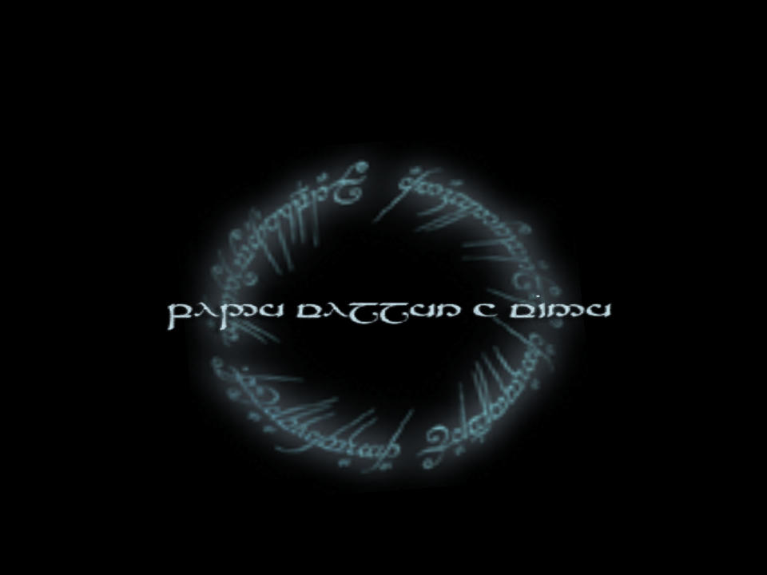
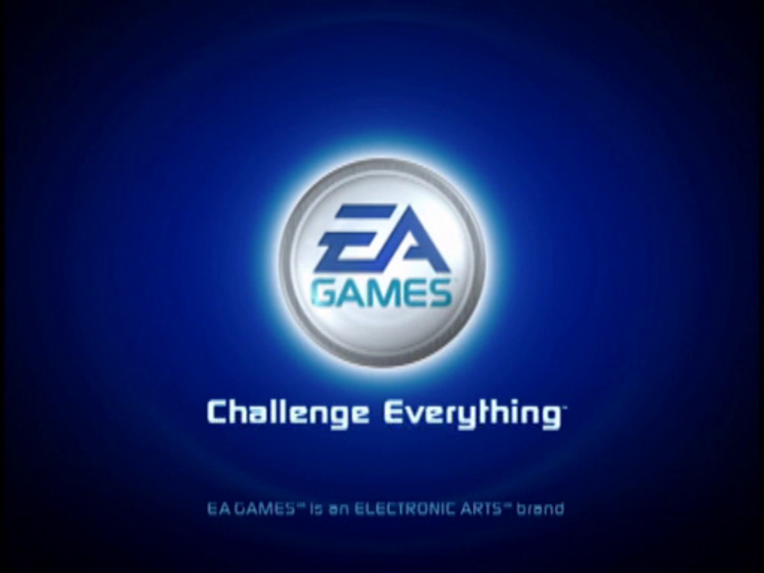
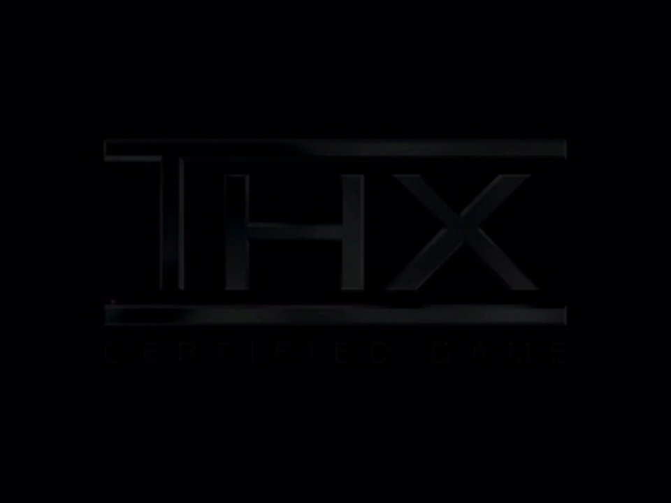

<div align="center">

# TLOTR_TTA_Recomp

**A native Windows, Linux and macOS port of *The Lord of the Rings: The Third Age* (NTSC-U, `SLUS-21027`), made by statically recompiling the game's PlayStation 2 code to C++.**<br>
Built on [BozoEngine](https://github.com/TheBozos/BozoEngine), The Bozos' own toolchain: the game's EE code recompiled to C++, every library and kernel call it makes answered by native code. No PS2 hardware model at any level: no GS, VU, VIF/GIF, DMA, IOP or SPU2.


</div>

> [!IMPORTANT]
> No game files are included: no ELF, IRX modules, data archives, or code generated from them.
> You need **your own copy** of the North American release, PS2 ID **`SLUS-21027`**. The port is built against that disc's executable:
>
> | File | SHA-1 |
> |---|---|
> | `SLUS_210.27` | `d88ded370592114169fa18f0ff73b9f610a94bd0` |

## Status

**Moving to BozoEngine (since 2026-11-09): the intro movies play in a window.** On the PS2Recomp fork the game
played from the boot to the first battle (the older screenshots below), but its graphics went through a PS2 emulation
layer (VU1 sandbox, GS state machine, GS memory). BozoEngine has none of it, so the picture comes back as native draw
hooks are written from the game's own data: the frame and the movies first (2026-11-10), then the 2D, the text and
the 3D. Windows comes first, then Linux and macOS.

| Milestone on BozoEngine | |
|---|:---:|
| Symbol map of the stripped ELF (BozoEngine's matcher against reference executables, then names read from the code) | ✅ |
| Recompile with `bozo-recomp`, a headless runner on the engine's free host | ✅ |
| SDK init, SIF, CD/DVD, memory card, IOP reboot and module loads answered natively | ✅ |
| EA's sound driver (AUDIOPF.IRX) and LIBSD statically compiled from the disc, its SIF handshake with the game | ✅ |
| Pads through a native libpad2 (BozoEngine PR #81) | ✅ |
| VU0 microprograms translated to C++ from the ELF; movies through a native libmpeg (BozoEngine PR #82) | ✅ |
| Native frame: the chain built but never sent, the swap publishing to the engine's renderer; the movies drawn | ✅ |
| Textures converted offline from the disc (tools/tta_textures.py); the 2D of LLPrims drawn natively: the loading screen | ✅ |
| Native draw hooks: menus (render targets, the UI atlas), text and 3D from the game's own data | 🔧 |
| Window, sound output, pad from the PC | ✅ |
| The game playable again to the first battle, then through | ⏳ |
| Linux and macOS builds | ⏳ |

The engine changes TTA needs are proposed upstream: [BozoEngine#80](https://github.com/TheBozos/BozoEngine/pull/80)
(IOP software registers, more cdvdman, audio completions after imports, root call budget) and
[BozoEngine#81](https://github.com/TheBozos/BozoEngine/pull/81) (native libpad2 and libvib) and
[BozoEngine#82](https://github.com/TheBozos/BozoEngine/pull/82) (libmpeg on the SDK's model: sceMpegAddBs); the
submodule points at `tta/integration`, the three merged, until they land.

✅ works · 🔧 in progress · ⏳ not reached yet

[docs/RECOMP_NOTES.md](docs/RECOMP_NOTES.md) records how the port is brought up, every fix and how it was found, and
what remains open.

## Screenshots

<p align="center">
  
</p>

**2026-11-10.** The loading screen drawn natively: the game's own primitive calls and draw state, with its
textures converted once from the disc and found by the game's texture records. No GS packet is read.

<p align="center">
  
  
</p>

**2026-11-10.** The first pictures on BozoEngine: the intro movies, decoded by the engine's native libmpeg and shown
by its renderer, at 60 frames/s. The game builds its frame's DMA chain as before; nothing of it is sent anywhere.

From the PS2Recomp build, until 2026-11-09.

<p align="center">
  
</p>

**2026-10-29.** The Black Riders' cinematic with the VU1 sandbox (now the default): no VU1 program runs on the
emulated VU1 unit, the native adapter runs each one in a sandbox and hands what it draws to the OpenGL renderer in GS
order, replaying each packet's GS register writes. That is still emulation (VU1 microcode, GS state machine), see
above. The first battle, its scene unlock and the film clip after it match the VU1 path, at the same
frame rates (19.5 in battle).

<p align="center">
  
  
</p>

**2026-10-29.** The first battle played to its end with the Cross button alone (a pad script): the Black Riders'
cinematic, the scene it unlocks (Nazgul Agenda, 2/109) and the film clip that follows, in one 11-minute run.

<p align="center">
  
</p>

**2026-10-29.** The first battle (Berethor against two Black Riders), reached with the defaults only: the native
OpenGL renderer, the IOP modules recompiled, the game on the PC's clock. What crashed the intro cinematic in most runs
was CD reads completing at once; they now take drive-like time.

<p align="center">
  
</p>

**2026-10-29.** After New Game: the in-engine intro cinematic, the game's own 3D drawn by the native OpenGL renderer.

<p align="center">
  
  
</p>

**2026-10-28.** The title screen, after the EA GAMES and New Line Cinema movies; the attract movie plays and returns
to it. The movies end the way the game signals it (its no-data callback returns 0), fork `tlotr/mpeg-nodata-end`.

<p align="center">
  
  
  
  
</p>

**2026-10-27.** The loading screen, the memory card check, the legal screen and the first boot movie, drawn by the
recompiled code. The disc is read
through the game's own IOP sound and streaming module, and the VU1 microprograms run AOT-compiled (with exact
MAC/status flags for now). The white band on the right is outside the 516-pixel-wide area the game draws in this
build.

<details>
<summary>2026-10-26: first frames</summary>

<p align="center">
  
</p>

The ring of the loading screen turned, but its text was garbled and the game never read the disc.
</details>

## Goal

A fully playable *The Third Age* as a native executable on Windows, Linux and macOS, from the intro to the end of the
campaign. Accuracy first; once it is playable, widescreen and higher internal resolution.

## How it works

```
disc (your ISO) ──► scripts/extract_iso.sh ──► game/ (SLUS_210.27, MODULES/*.IRX)
                                   │
 recomp/tta_symbols.txt (names for the stripped ELF: scripts/symbols.sh) + runtime/ overrides
                                   │
        bozo-externals ──► the externals list   bozo-recomp ──► C++ (build/bozo/tta_gen/)
        tools/tta_bozo_audio.py ──► AUDIOPF.IRX and LIBSD.IRX as C++ (BozoEngine tools/native_irx)
                                   │
              CMakeLists.txt ──► BozoEngine runtime + generated code + runtime/ ──► tta-headless
```

- The retail executable is stripped. `recomp/tta_symbols.txt` names its library and kernel functions:
  BozoEngine's `bozo_symbolmap.py` matches them against executables that keep their symbols, and
  `recomp/tta_symbols_reviewed.txt` adds the ones read from the code, each with its evidence
  (`tools/tta_rpc_names.py` pairs SIF RPC clients with their server and function number to help).
  Every named function BozoEngine knows is answered natively.
- `runtime/tta_port.cpp` registers the port's overrides by address; `runtime/tta_audio.cpp` runs EA's sound driver
  in the engine's compiled-library host and connects it to the game (SIF commands, software registers).
- Nothing derived from the disc is committed: the generated code and the compiled IRX are in `build/`.

## Requirements

- Windows 10/11 with [MSYS2](https://www.msys2.org/) (UCRT64), Linux, or macOS
- CMake 3.21+, Ninja, GCC 13+ or Clang with C++20
- FFmpeg development libraries (`libavcodec`, `libavformat`, `libavutil`, `libswresample`, `libswscale`) and `pkg-config`
- `bsdtar` (libarchive) to extract the disc, Python 3
- To regenerate the symbol map: reference executables that keep their symbols (scripts/symbols.sh)
- A CPU with AVX2 (the runtime is built for `x86-64-v3`)
- Your own copy of `SLUS-21027` (check the hash above)

## Build and run

```bash
git clone --recurse-submodules https://github.com/TheBozos/TLOTR_TTA_Recomp.git
cd TLOTR_TTA_Recomp
scripts/extract_iso.sh "/path/to/Lord of the Rings, The - The Third Age (USA).iso"   # disc files -> game/
scripts/build_runtime.sh                       # recompile + sound driver + runtime -> build/bozo
scripts/run.sh --frames 600                    # tta-headless: runs and reports what is not native yet
```

### Windows

The same scripts run in an MSYS2 **UCRT64** shell, with MSYS2's GCC (MSVC is not supported for this port).

```bash
pacman -S --needed mingw-w64-ucrt-x86_64-{gcc,cmake,ninja,pkgconf,ffmpeg,libarchive,python} git
```

## Sharing the machine with other ports

The Bozos' ports share a two-slot bench lock (BozoEngine's `tools/bench_lock.sh`): a game run takes one slot, a build
or a timed run both, in arrival order.

```bash
scripts/bench_run.sh 5 "headless boot" scripts/run.sh --frames 600
scripts/bench_run.sh --alone 30 "full rebuild" scripts/build_runtime.sh
```

## Legal

This project contains no code or data from the game. You must own the game to use it. *The Lord of the Rings: The
Third Age* is a trademark of its respective owners; this project is not affiliated with or endorsed by them.
